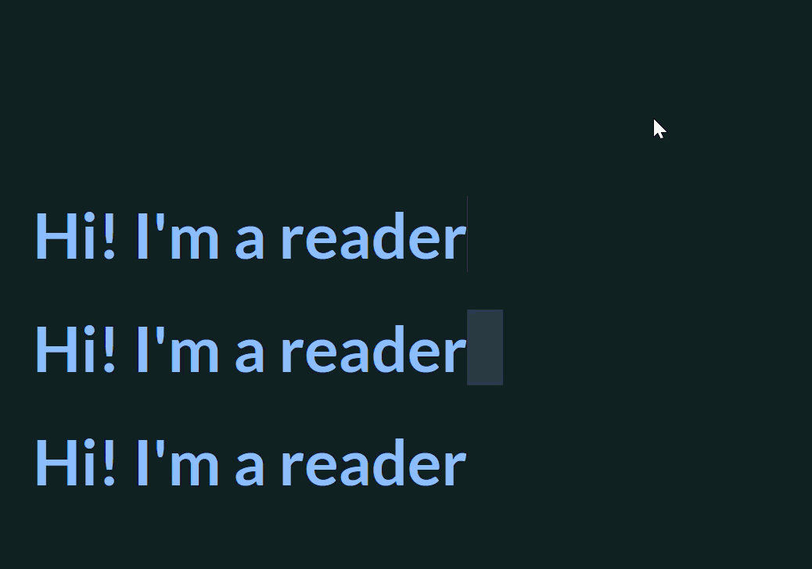

# typewriter-effect-in-pure-css

This works well for hero sections where you want to cycle through a handful of words or roles without relying on JavaScript. Developers typically use them for their portfolio sites. Just make sure the background behind the text is a solid color that matches the page, otherwise, the typing effect can expose the edge of the animation.



Source: https://prismic.io/blog/css-animation-examples

This works well for hero sections where you want to cycle through a handful of words or roles without relying on JavaScript. Developers typically use them for their portfolio sites.

Just make sure the background behind the text is a solid color that matches the page, otherwise, the typing effect can expose the edge of the animation.

Prismic integration
This animation is one of the few in this guide that isn't editor-friendly. Since every keyframe is based on the exact number of characters in each word, the CSS can't simply pull values from a Key Text or Rich Text field.

One way around that is to store the words in a repeatable Group field and generate the keyframes when the Slice renders. A helper like buildTypewriterKeyframes below can calculate the timing for each word automatically, so editors can add, remove, or reorder words without having to ask developers to manually update the animation.

### Dynamic Typewriter Component

```tsx
// slices/TypewriterHero/index.tsx
export default function TypewriterHero({ slice }: TypewriterHeroProps) {
  const words = slice.primary.words.map((item) => item.word);
  const keyframeCSS = buildTypewriterKeyframes(words);

  return (
    <section className="hero">
      <style>{keyframeCSS}</style>
      <h1>
        I'm a <span className="typewriter" />
      </h1>
    </section>
  );
}
```

### Keyframe Generator

The helper below dynamically creates CSS keyframes from a list of words. Instead of manually calculating percentages for each word and character, the animation is generated automatically based on the content provided through Prismic.

```ts
// Custom helper, not a Prismic API. Turns a word list into the same kind of
// typing keyframes shown in the CSS above, just generated instead of hand-counted.
function buildTypewriterKeyframes(words: string[]): string {
  const slot = 100 / words.length; // % of the timeline each word gets
  const stops: string[] = [];

  words.forEach((word, i) => {
    const start = i * slot;

    // Type the word in, one character per stop
    for (let c = 0; c <= word.length; c++) {
      const percent = start + (c / word.length) * (slot * 0.4);
      stops.push(`${percent.toFixed(2)}% { content: "${word.slice(0, c)}"; }`);
    }

    // Jump straight to blank before the next word's slot begins
    stops.push(`${(start + slot - 0.01).toFixed(2)}% { content: ""; }`);
  });

  return `@keyframes typing {\n  ${stops.join("\n  ")}\n}`;
}
```
